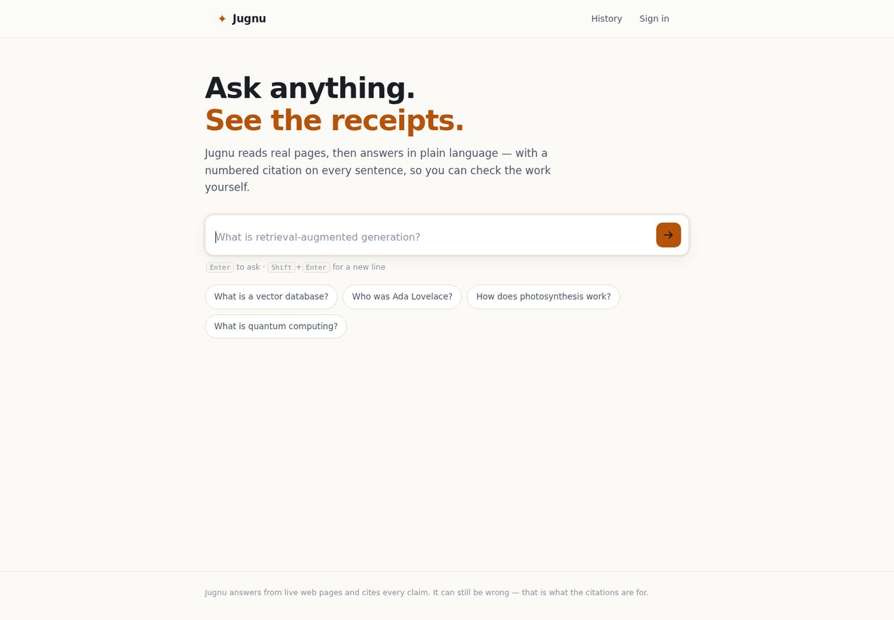
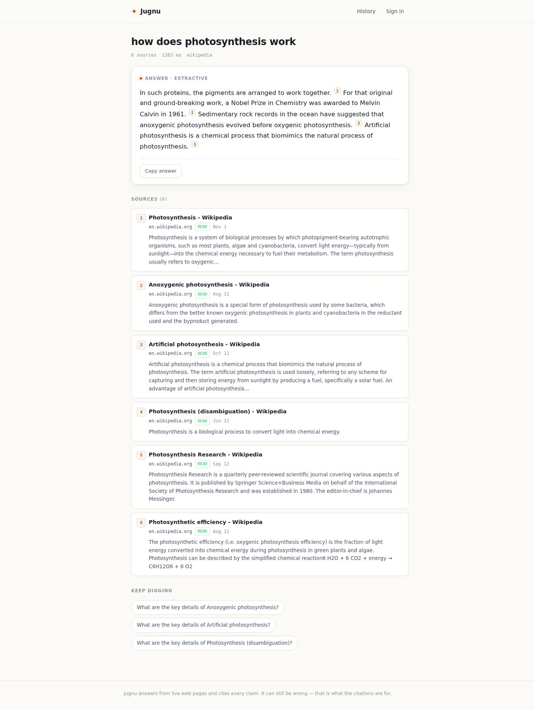

# Jugnu ✦

**Ask anything. See the receipts.**

A conversational search engine that answers in plain language and puts a
numbered citation on every sentence — so you can check the work yourself
instead of taking its word for it.

[](https://www.python.org/)
[](https://fastapi.tiangolo.com/)
[](#tests)
[](https://docs.astral.sh/ruff/)
[](LICENSE)

---

## Why this exists

Every AI search tool says "here are my sources." Almost none of them make it
easy to check whether a specific sentence actually came from one of them.

Jugnu does. Ask *what is a vector database* and you get a short answer where
each sentence ends in a small numbered pill. Click the pill, you land on the
exact source. The sentence is not a paraphrase — it is a sentence that exists on
that page, and the marker points at it.

That is the whole idea. Everything else is in service of it.

## Screenshots

**Ask** — one box, four example questions, nothing else competing for attention.



**Answer with citations** — every sentence carries a numbered marker; sources
are listed below with a "read" or "snippet only" badge so you know which pages
were actually opened.



**Sign in** — optional. Anonymous searches work; an account just keeps your
history.


**Mobile** — the same layout, one column, no horizontal scroll.


## Features

- **Cited answers.** Every sentence carries `[n]`, and `[n]` maps to a real
  source card. No citation, no claim.
- **Honest source badges.** A page we fetched and read is marked *read*. A page
  we only saw a search snippet for is marked *snippet only* — you can tell the
  difference at a glance.
- **Pluggable retrieval.** Wikipedia (no key needed), DuckDuckGo, Tavily, and
  SearXNG. Run several at once; results merge and de-duplicate.
- **Extractive by default.** No API key, no per-query cost, and structurally
  incapable of inventing a citation. Bring an LLM key if you want the fluent
  version — the citation guardrail stays on.
- **Conversation threads.** Follow-ups keep context. Rename, share, or delete
  any thread.
- **Public share links.** One click produces a read-only URL anyone can open.
- **Real auth.** bcrypt + JWT, with the boring-but-correct details: no account
  enumeration, 404 instead of 403 on other people's threads.
- **136 tests.** Ranking, cleaning, auth, ownership and rate limiting are all
  covered, and the suite runs offline in about two seconds.

## Quick start

```bash
git clone https://github.com/mohdabrarbaloch-arch/day-19-jugnu.git
cd day-19-jugnu

python -m venv .venv && source .venv/bin/activate
pip install -e ".[dev]"

cp .env.example .env          # defaults work as-is
python -m app.seed            # optional: creates a demo account
uvicorn app.main:app --reload
```

Open <http://127.0.0.1:8000>. That's it — no API key required, because the
default provider is Wikipedia.

Demo account, if you ran the seed: `demo@jugnu.app` / `demo12345`.

### With Docker

```bash
docker compose up --build
```

Brings up the app on port 8000 and Postgres on 5432.

## Configuration

Everything is environment-driven. See `.env.example` for the full list with
comments. The ones that matter most:

| Variable | Default | What it does |
|---|---|---|
| `SEARCH_PROVIDERS` | `wikipedia` | Comma-separated, in priority order |
| `ANSWER_PROVIDER` | `extractive` | `extractive`, `openai`, or `anthropic` |
| `TAVILY_API_KEY` | — | Enables the Tavily provider |
| `SEARXNG_URL` | — | Point at your own SearXNG instance |
| `DATABASE_URL` | `sqlite:///./jugnu.db` | Postgres URL for production |
| `SECRET_KEY` | dev value | **Change this in production** |
| `RATE_LIMIT_ENABLED` | `true` | Turn off in tests |

## API

Full reference in [`docs/api.md`](docs/api.md). The short version:

```bash
# Ask a question (no account needed)
curl -X POST http://127.0.0.1:8000/api/search \
  -H 'Content-Type: application/json' \
  -d '{"question": "what is a vector database"}'
```

```jsonc
{
  "thread_id": "6a500d7a…",
  "query": {
    "question": "what is a vector database",
    "answer": "A vector database … in vector space. [1] Vector databases typically … [1]",
    "provider_used": "wikipedia",
    "answer_provider": "extractive",
    "latency_ms": 1652,
    "source_count": 6,
    "sources": [
      {
        "rank": 1,
        "title": "Vector database - Wikipedia",
        "url": "https://en.wikipedia.org/wiki/Vector_database",
        "domain": "en.wikipedia.org",
        "snippet": "A vector database, vector store or vector search engine …",
        "relevance": 0.86,
        "fetched_ok": true
      }
    ]
  },
  "follow_ups": ["How does Similarity search work?", "…"]
}
```

## Tests

```bash
pytest -q          # 136 tests
ruff check .       # lint
ruff format --check .
```

The suite is offline and deterministic. The search endpoint is exercised
against a stubbed engine, so no test ever hits the network.

## Project layout

```
app/
  main.py              app factory, middleware, error handlers
  config.py            every setting, read from the environment
  db.py                engine + session
  models.py            User, Thread, Query, Source
  schemas.py           bounded request/response models
  security.py          bcrypt, JWT, current-user dependency
  rate_limit.py        sliding-window limiter
  routers/             auth, search, threads, public
  search/
    engine.py          retrieve → fetch → rank → synthesise → persist
    answer.py          extractive synthesis + LLM path with citation guard
    fetcher.py         HTTP fetch + HTML → prose
    text.py            tokenise, split, BM25, passage selection
    cache.py           TTL + LRU
    providers/         wikipedia, duckduckgo, tavily, searxng
  static/              index.html, styles.css, app.js
tests/                 136 tests
docs/                  setup, usage, api
```

## Deployment

The app is a standard ASGI service. On Vercel, `vercel.json` plus
`api/index.py` route everything to the FastAPI app.

**One caveat worth reading before you deploy:** Vercel's filesystem is
read-only except `/tmp`, and `/tmp` does not survive between invocations. With
the default SQLite database, threads and accounts will disappear. For a real
deployment, set `DATABASE_URL` to a hosted Postgres (Neon, Supabase, RDS) —
that is the only change required.

## License

MIT — see [LICENSE](LICENSE).

---

Built as Day 19 of a 30-day build challenge. The name is Urdu for *firefly* —
a small light that helps you see where you're going.
